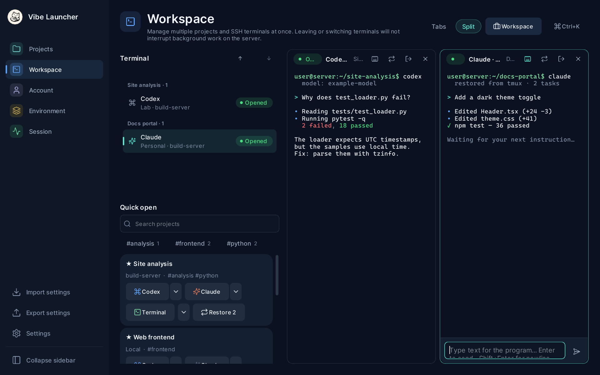
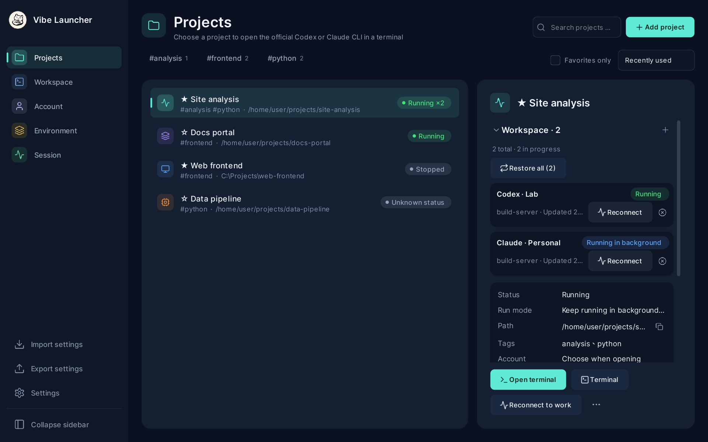
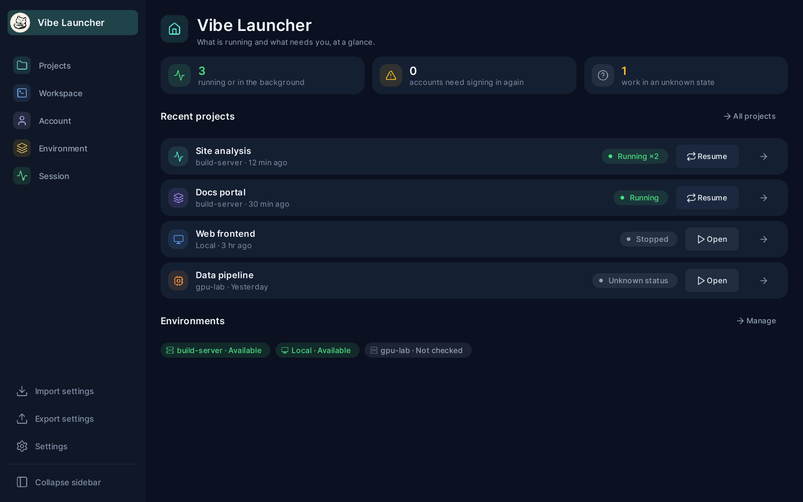
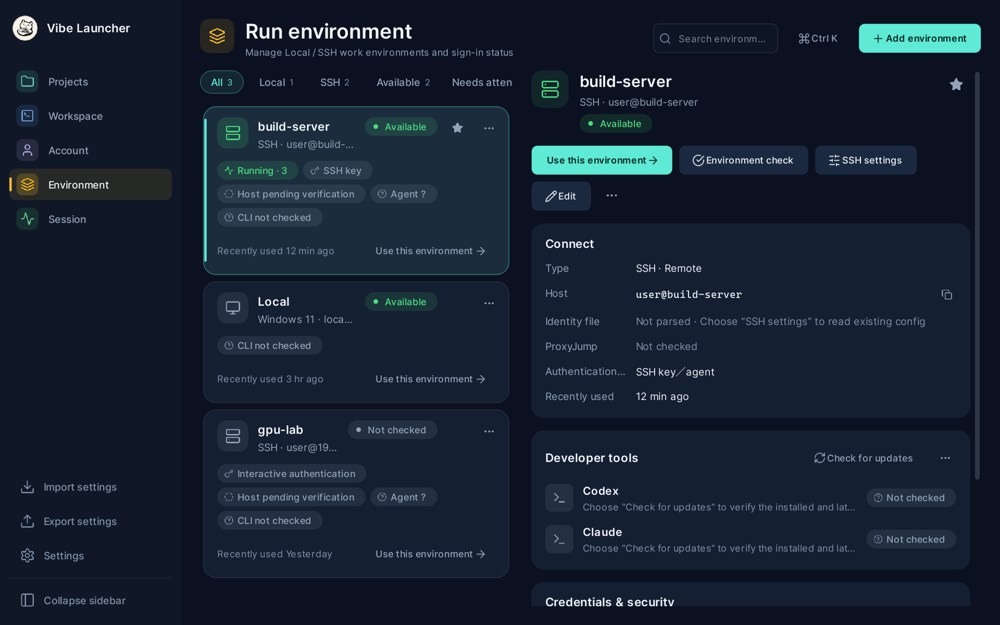
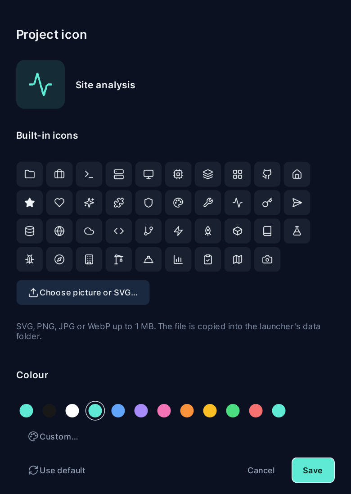

# Vibe Launcher

English | [繁體中文](README.zh-TW.md) | [简体中文](README.zh-CN.md)

A desktop launcher for the official **Codex CLI** and **Claude Code**, on this PC or on Linux hosts over SSH.
It runs on **Windows 10/11** today; a **Linux desktop version (Ubuntu first)** is planned (see [Planned](#4-planned)).
Sign in once per account, keep every account in its own profile, open projects in a built-in terminal workspace, and
let SSH work keep running in tmux after you close the window.

- Accounts never touch your own `~/.codex` / `~/.claude`: each one gets a private profile.
- Projects are not tied to an account; you pick the account when you open one.
- Remote work survives disconnects (tmux) and can be re-attached, stopped or recalled later.
- Sign-in always happens in the official CLI / browser; the launcher never handles OAuth tokens.



## 1. Set up

### What you need first

**On Windows (this PC)**

| Requirement | Notes |
| --- | --- |
| Windows 10 1809+ or Windows 11 | The built-in terminal uses ConPTY. |
| Python 3.11+ and [uv](https://docs.astral.sh/uv/) | Use a full Python install, not one embedded in another app. |
| Git | Needed to run from a checkout and for in-app updates. |
| Windows OpenSSH Client | Only for SSH environments (`ssh.exe`, an optional Windows feature). |
| Official CLIs you plan to use | `codex` / `claude` as native `.exe` on `PATH` (`.cmd` / `.bat` wrappers are not run). |
| Optional: Git + [GitHub CLI](https://cli.github.com/) (`gh`) | Only for binding a GitHub account to a project. |

**On each Linux SSH host**

| Requirement | Notes |
| --- | --- |
| `/usr/bin/python3` 3.10+ with `lzma` | Runs the launcher's helper script (standard library only). |
| **tmux** | Required for projects that keep running after the terminal closes (the default). |
| `codex` and/or `claude` | Found on the non-interactive SSH `PATH` or in `~/.local/bin`, `~/.npm-global/bin`, `~/.bun/bin`, nvm… |
| Optional: `git`, `gh` | For GitHub binding on that host. |

```bash
# Debian / Ubuntu example; then install the CLIs with their official installers
sudo apt install tmux python3
ssh user@server 'echo $PATH; which -a python3 tmux codex claude'   # what the launcher will see
```

The launcher installs nothing on your hosts and never edits your SSH config or keys. Host keys are confirmed by you
in the terminal on first connect.

### Install and run

**Installer (recommended).** Download `Vibe-Launcher-Setup-<version>.exe` from the
[Releases](https://github.com/catplaysdev/vibe-launcher/releases) page and run it. It installs for your user only (no
administrator rights) and needs no Python, uv or Git for the launcher itself; the requirements above still apply to the
tools you open with it. Check the download against `SHA256SUMS.txt` from the same release. When a newer release exists,
**Settings › About and updates** shows its notes and updates in place (your data is backed up first). The check is one
small request at most every six hours and can be switched off; nothing runs in the background otherwise.

**From source.**

```powershell
git clone <repository-url> vibe-launcher
cd vibe-launcher
uv sync
uv run vibe-launcher
```

Optional desktop shortcut: `powershell -NoProfile -ExecutionPolicy Bypass -File scripts/create-shortcut.ps1`.
Data lives in `%LOCALAPPDATA%\VibeLauncher` (override with `VIBE_LAUNCHER_HOME`).

## 2. Getting started

1. **Accounts → Add**: Codex or Claude, subscription or API (API needs a model ID; an empty endpoint means the official API).
2. **Environments**: *Local* is built in. For a server, add an SSH environment using a `Host` alias from
   `~/.ssh/config` or `user@host`, then run **Environment check**.
3. **Accounts → Sign in**: pick the environment and finish the official sign-in in the terminal/browser.
   A subscription sign-in lives on the machine where you did it; API accounts work everywhere.
4. **Projects → New project**: name, environment and an absolute folder path (`~/my-app` works on SSH).
   Click **Open**, choose an account, and the CLI starts in the **Workspace**.
5. To leave SSH work running, press **Detach** (`Ctrl+Shift+D`). Re-attach later from the project, the Workspace or
   **Sessions**.

Useful keys: `Ctrl+K` command palette, `Ctrl+,` settings, `Ctrl+Tab` next terminal, `Ctrl+=` / `Ctrl+-` terminal text
size, `Ctrl+Shift+Space` keyboard navigation. All shortcuts can be changed in **Settings → Keyboard shortcuts**.



## 3. Features

- **Isolated accounts**: one `CODEX_HOME` / `CLAUDE_CONFIG_DIR` per account; optional one-off import of your skills,
  hooks, agents and conversations (copied from an allow-list, never credentials).
- **Local and SSH environments**: status cards (host trust, auth mode, agent, CLI versions), remote folder browser,
  optional SSH password caching in Windows Credential Manager, CLI version check and update.
- **Projects**: tags and filters, favourites, custom project icons (glyph, picture or recoloured SVG), a drawer listing
  every workspace a project has, and one-click **recall** (re-attach running work, reopen stopped work).
- **Workspace**: xterm.js terminals in tabs or a grid, a native input bar for IME input (e.g. Chinese), quick open per
  project, saved workspace layouts, shell / CLI profile choice, zoomable text.
- **Sessions**: every run with its real status (from the remote supervisor's exit code, not terminal output); bulk
  stop / clean-up, grouped by project or time.
- **Integrations**: GitHub account and commit identity per project (official `gh`), Codex quota view,
  DeepSeek Harness Web (experimental).
- **Customisation**: 8 colour themes and accent colours, separate interface and terminal fonts, interface scale (80–200%), English / 繁體中文 / 简体中文 / 日本語 / 한국어 / Deutsch / Español UI,
  CLI plugin manifests in `settings.json`.
- **Safe updates**: checks git tags, backs up the database and settings, then `git pull --ff-only` + `uv sync`.

<table>
  <tr>
    <td width="40%"><br><sub>Home</sub></td>
    <td width="40%"><br><sub>Environments</sub></td>
    <td width="20%"><br><sub>Project icon</sub></td>
  </tr>
</table>

<sub>Screenshots use made-up sample data (regenerate with `scripts/readme_screenshots.py`).</sub>

Full details, security notes and limits (Traditional Chinese): [docs/guide.zh-TW.md](docs/guide.zh-TW.md).
Manual end-to-end checklist: [docs/acceptance.md](docs/acceptance.md).

## 4. Planned

Confirmed and not yet built:

- **Linux desktop (Ubuntu first)**: run the launcher itself on Linux, not only connect *to* Linux hosts. Today the launcher is Windows-only; the parts tied to Windows (ConPTY terminal layer, Windows OpenSSH / Credential Manager, native title bar) need Linux counterparts (a PTY layer, the system `ssh`, Secret Service / keyring). The remote side (tmux on a Linux host) is already platform-independent. Not available yet; development and testing happen on Ubuntu first, and the platform list above will change when it ships.
- **Git graph**: view a project's branches and commit graph inside the launcher.
- **SSH over VPN**: let an SSH environment declare the VPN it needs, and check (or bring up) that VPN before connecting.

## Development

Choose the interface language in **Settings → General → Interface language**, then restart the launcher. English is the default. UI text is maintained in `src/vibe_launcher/locales/`: `en`, `zh-TW`, `zh-CN`, `ja`, `ko`, `de` and `es`. The translation checker validates every registered catalog's keys, format fields and HTML markup.

```powershell
uv run --group dev pytest -q
uv run python scripts/check_translations.py
```

Contribution rules, branch workflow and release steps: [AGENTS.md](AGENTS.md). Changes: [CHANGELOG.md](CHANGELOG.md).
Brand icons (Codex / Claude / DeepSeek) are not shipped; put your own `codex.svg`, `claude.svg`, `deepseek.svg` in
`src/vibe_launcher/assets/brand/` (ignored by git) to show them.

## License

Vibe Launcher is free software under the **GNU General Public License v3.0 or later** ([LICENSE](LICENSE)): you may use,
study, change and share it, and anyone who distributes it or a modified version must do so under the same licence and
provide the source. Third-party components and their licences: [THIRD_PARTY_NOTICES.md](THIRD_PARTY_NOTICES.md). Codex,
Claude and other product names belong to their owners and are not part of this project.
