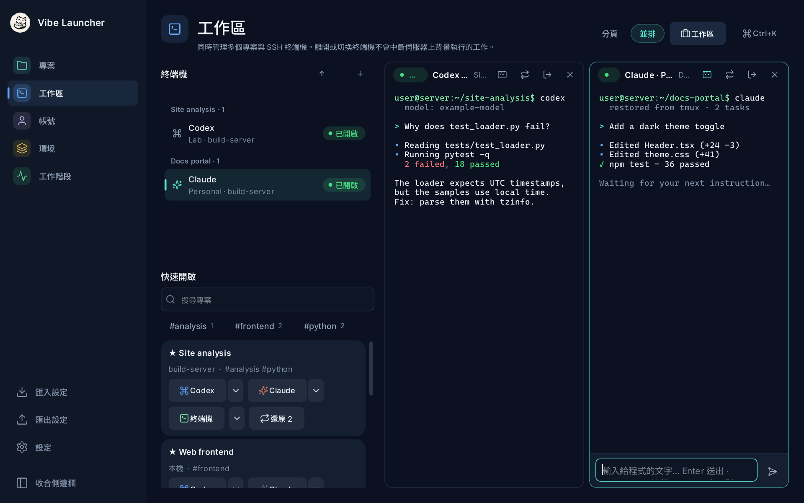
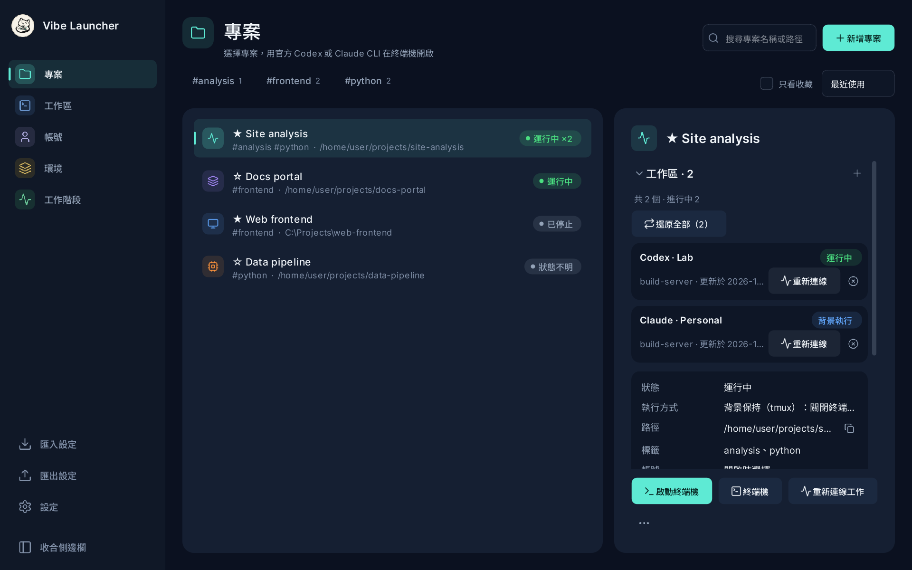
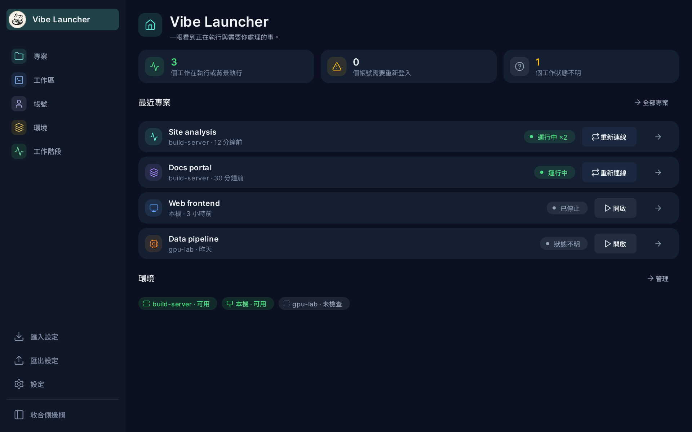
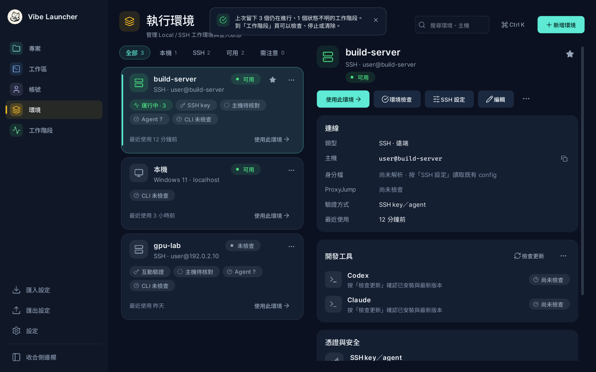
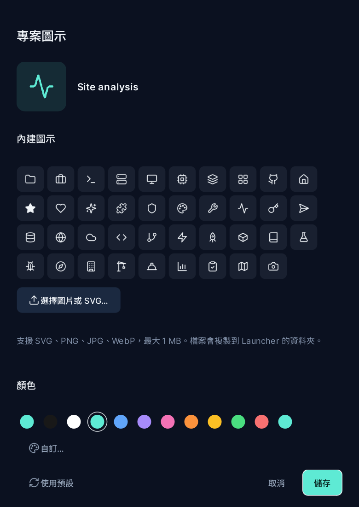

# Vibe Launcher

[English](README.md) | [繁體中文](README.zh-TW.md) | 简体中文

桌面启动器，在本机或 Linux SSH 主机上打开官方 **Codex CLI** 与 **Claude Code**。
目前支持 **Windows 10/11**，并计划支持 **Linux 桌面版（优先 Ubuntu）**（见[后续计划](#4-已确定的后续计划)）。
每个账号登录一次、各自独立 profile；项目在内置终端工作区中打开；SSH 任务由 tmux 保留，关闭窗口后继续运行。

- 账号不会改动你自己的 `~/.codex`／`~/.claude`，每个账号都有自己的私有 profile。
- 项目不绑定账号，打开时再选择使用哪个账号。
- 远程任务断线后继续运行（tmux），之后可以重新连接、停止或一键召回。
- 登录始终在官方 CLI／浏览器中完成；Launcher 不经手 OAuth token。



## 1. 搭建环境

### 准备工作

**Windows（本机）**

| 要求 | 说明 |
| --- | --- |
| Windows 10 1809 及以上或 Windows 11 | 内置终端使用 ConPTY。 |
| Python 3.11+ 与 [uv](https://docs.astral.sh/uv/) | 请使用完整安装的 Python，不要用其他软件内嵌的版本。 |
| Git | 从源码运行和应用内更新需要。 |
| Windows OpenSSH Client | 仅 SSH 环境需要（`ssh.exe`，Windows 可选功能）。 |
| 需要使用的官方 CLI | `codex`／`claude` 原生 `.exe` 需在 `PATH` 中（不会执行 `.cmd`／`.bat` 包装脚本）。 |
| 可选：Git + [GitHub CLI](https://cli.github.com/)（`gh`） | 仅在项目绑定 GitHub 账号时需要。 |

**每台 Linux SSH 主机**

| 要求 | 说明 |
| --- | --- |
| `/usr/bin/python3` 3.10+（含 `lzma`） | 运行 Launcher 的辅助脚本（只用标准库）。 |
| **tmux** | “关闭终端后继续运行”的项目（默认）必须安装。 |
| `codex` 和／或 `claude` | 位于 SSH 非交互 shell 的 `PATH`，或 `~/.local/bin`、`~/.npm-global/bin`、`~/.bun/bin`、nvm 等位置。 |
| 可选：`git`、`gh` | 在该主机绑定 GitHub 时需要。 |

```bash
# Debian／Ubuntu 示例；CLI 请用官方方式安装
sudo apt install tmux python3
ssh user@server 'echo $PATH; which -a python3 tmux codex claude'   # Launcher 将看到的结果
```

Launcher 不会在主机上安装任何东西，也不会修改 SSH 配置或密钥；首次连接的主机指纹由你在终端中确认。

### 安装与运行

**安装程序（推荐）**：到 [Releases](https://github.com/catplaysdev/vibe-launcher/releases) 下载
`Vibe-Launcher-Setup-<版本>.exe` 并运行。只为当前用户安装（无需管理员权限），Launcher 本身不需要 Python、uv 或 Git；
上面列出的要求仍适用于你用它打开的工具。可用同一个 Release 的 `SHA256SUMS.txt` 核对下载文件。之后有新版本时，
“设置 › 关于与更新”会列出更新内容并可直接更新（会先备份你的数据）。检查最多每六小时一次、只有一个小请求，也可以关闭；
其余时间不会有任何后台进程。

**从源码运行**：

```powershell
git clone <repository-url> vibe-launcher
cd vibe-launcher
uv sync
uv run vibe-launcher
```

创建桌面快捷方式（可选）：`powershell -NoProfile -ExecutionPolicy Bypass -File scripts/create-shortcut.ps1`。
数据保存在 `%LOCALAPPDATA%\VibeLauncher`（可用 `VIBE_LAUNCHER_HOME` 修改位置）。

## 2. 快速上手

1. **账号 → 新增**：Codex 或 Claude，选择订阅或 API（API 需填写模型 ID；endpoint 留空表示官方 API）。
2. **环境**：“本机”已内置。服务器请新增 SSH 环境，填写 `~/.ssh/config` 中的 `Host` 别名或 `user@host`，再点“环境检查”。
3. **账号 → 登录**：选择环境，在终端／浏览器中完成官方登录。订阅登录只保存在执行登录的那台机器上；API 账号在任何环境都可用。
4. **项目 → 新建项目**：名称、环境和文件夹绝对路径（SSH 可用 `~/my-app`）。点“打开”并选择账号，CLI 会在“工作区”中启动。
5. 想让 SSH 任务继续运行，点“离开”（`Ctrl+Shift+D`）。之后可从项目、工作区或“会话”重新连接。

常用按键：`Ctrl+K` 命令面板、`Ctrl+,` 设置、`Ctrl+Tab` 下一个终端、`Ctrl+=`／`Ctrl+-` 终端文字大小、
`Ctrl+Shift+Space` 键盘导航。所有快捷键都可在“设置 → 快捷键”中修改。



## 3. 功能

- **账号隔离**：每个账号独立的 `CODEX_HOME`／`CLAUDE_CONFIG_DIR`；可手动导入你的 skills、hooks、agents 与对话（按白名单复制，不含凭据）。
- **本机与 SSH 环境**：状态卡片（主机信任、认证方式、agent、CLI 版本）、远程文件夹浏览、可选的 SSH 密码缓存（Windows 凭据管理器）、CLI 版本检查与更新。
- **项目**：标签与筛选、收藏、自定义项目图标（内置图标、图片或可换色的 SVG）、列出项目所有工作区的抽屉，以及一键“召回”（重新连接仍在运行的、重新打开已停止的）。
- **工作区**：xterm.js 终端，标签页或平铺；原生输入栏方便输入法（中文）输入；每个项目的快速打开；保存工作区布局；选择 shell／CLI；文字可缩放。
- **会话**：每次运行的真实状态（依据远程监督进程的退出码，而不是终端输出）；批量停止／清理，可按项目或时间分组。
- **集成**：每个项目的 GitHub 账号与 commit 身份（官方 `gh`）、Codex 额度查询、DeepSeek Harness Web（实验性）。
- **个性化**：8 套主题与强调色、界面字体与终端字体（可分别选择）、界面缩放（80–200%）、英语／繁体中文／简体中文／日语／韩语／德语／西班牙语界面、`settings.json` 中的 CLI 扩展 manifest。在“设置 → 常规 → 界面语言”中选择语言，重启启动器后生效。
- **安全更新**：比对 git tag，先备份数据库与设置，再执行 `git pull --ff-only` + `uv sync`。

<table>
  <tr>
    <td width="40%"><br><sub>首页</sub></td>
    <td width="40%"><br><sub>环境</sub></td>
    <td width="20%"><br><sub>项目图标</sub></td>
  </tr>
</table>

<sub>截图使用虚构的示例数据（可用 `scripts/readme_screenshots.py` 重新生成），界面为繁体中文。</sub>

完整说明、安全细节与限制（繁体中文）：[docs/guide.zh-TW.md](docs/guide.zh-TW.md)。人工端到端验收清单：[docs/acceptance.md](docs/acceptance.md)。

## 4. 已确定的后续计划

- **Linux 桌面版（优先 Ubuntu）**：让 Launcher 本身也能在 Linux 上运行，而不只是连接*到* Linux 主机。目前仅支持 Windows；与 Windows 绑定的部分（ConPTY 终端层、Windows OpenSSH／凭据管理器、原生标题栏）需要对应的 Linux 实现（PTY 层、系统 `ssh`、Secret Service／keyring）。远程的 tmux 流程本来就与平台无关。尚未提供；会先在 Ubuntu 上开发和测试，正式支持时再更新上方的平台要求。
- **Git graph**：在 Launcher 内查看项目的分支与 commit 图。
- **SSH 配合 VPN**：SSH 环境可指定所需的 VPN，连接前先检查（或启动）该 VPN。

## 开发

界面文案集中维护在 `src/vibe_launcher/locales/` 目录，翻译检查器会校验各语言键值、格式占位符和 HTML 标签的一致性。

```powershell
uv run --group dev pytest -q
uv run python scripts/check_translations.py
```

协作规则、分支流程与发布步骤见 [AGENTS.md](AGENTS.md)；变更记录见 [CHANGELOG.md](CHANGELOG.md)。
Codex／Claude／DeepSeek 的品牌图标不随程序发布；如需显示，请自行将 `codex.svg`、`claude.svg`、`deepseek.svg`
放入 `src/vibe_launcher/assets/brand/`（不纳入版本控制）。

## 许可证

Vibe Launcher 是自由软件，以 **GNU General Public License v3.0 或更新版本**（[LICENSE](LICENSE)）发布：你可以使用、研究、修改和分享；
分发本程序或修改版的人，也必须以相同许可证并提供源代码。第三方组件及其许可证见 [THIRD_PARTY_NOTICES.md](THIRD_PARTY_NOTICES.md)。
Codex、Claude 等名称属于各自的所有者，并非本项目的一部分。
